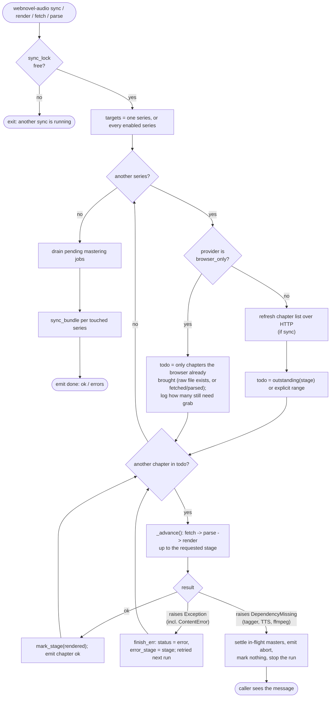
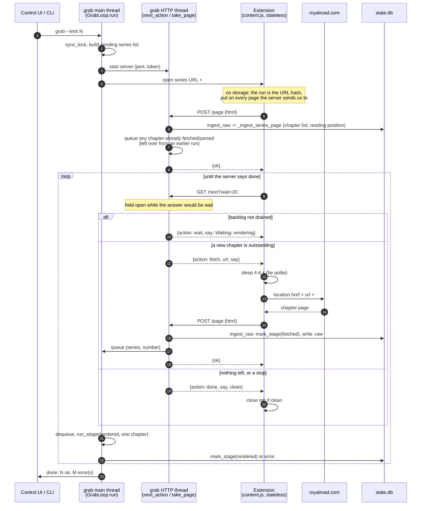

# How sync and browser fetch work

How a chapter gets from "listed on the site" to "rendered audio", and how the
browser extension takes part in it. This is a description of the code as it is,
including the places where it is fragile; see [Known problems](#known-problems).

Source files (line numbers are as of this writing):

| piece | where |
|---|---|
| chapter state machine | [`db.py`](../src/webnovel_audio/db.py) `STAGES`, `outstanding` (:532), `mark_stage` (:553) |
| stage runner (`sync`, `render`, `fetch`, `parse`) | [`sync.py`](../src/webnovel_audio/sync.py) `run_stage` (:1110), `_advance` (:1077) |
| one-process-at-a-time lock | [`sync.py`](../src/webnovel_audio/sync.py) `sync_lock` (:47) |
| page ingest from a browser | [`sync.py`](../src/webnovel_audio/sync.py) `ingest_raw` (:873), `_ingest_series_page` (:837) |
| `grab` loop and its HTTP server | [`grab.py`](../src/webnovel_audio/grab.py) `GrabLoop` (:138), `next_action` (:236), `take_page` (:282), `run` (:342), `_server` (:460) |
| extension | [`content.js`](../extension/royalroad-grabber/content.js) `serverStep` (:165), [`background.js`](../extension/royalroad-grabber/background.js) |
| render refuses without the POS tagger | [`pipeline.py`](../src/webnovel_audio/pipeline.py) (:206) |
| the CLI entry points | [`cli.py`](../src/webnovel_audio/cli.py) `_cmd_grab` (:2283) |

## 1. The chapter state machine

`chapters.status` is the **only** notion of progress ([`db.py`](../src/webnovel_audio/db.py) header).

```
new -> fetched -> parsed -> rendered          (the ordered path, STAGES)
              \-> error  (+ error_stage: which stage broke)
              \-> skipped (deliberately not wanted)
```

- `db.outstanding(series, stage)` is the **declarative** work set: unlocked chapters
  not yet at `stage`, `skipped` honoured, `error` **retried**.
- `db.mark_stage` never moves a chapter backwards.
- An explicit `--range` is **imperative**: those chapters, whatever their state.

## 2. Sync (non-browser) and the stage runner

`sync` is `series refresh` + `render` over every enabled series
([`run_sync`](../src/webnovel_audio/sync.py), :1265). Everything runs through
`run_stage`.



Notes on the runner:

- Rendering overlaps: while one chapter is being loudness-mastered in a thread
  pool, the next is synthesizing. DB writes stay on the calling thread
  (`drain`, `settle`).
- The per-chapter handler is `except Exception`. Failures are classified in
  [`errors.py`](../src/webnovel_audio/errors.py): `ContentError` (one bad chapter) is an
  `Exception`, so the chapter is marked `error` and the run goes on; `DependencyMissing`
  (tagger, TTS model, ffmpeg, espeak, lexicon) is a `SystemExit`, caught by
  `run_stage`'s outer handler: it settles in-flight masters, emits `abort`, marks
  nothing and stops. `pipeline.preflight` checks the environment once, before the first
  render. `error` chapters are retried by the next run (`db.outstanding`).
- For a `browser_only` site (Royal Road) `sync` cannot fetch. It renders what the
  browser has already brought and tells the user to run `grab` for the rest.

## 3. Browser fetch (`grab`)

Royal Road answers plain HTTP with a bot check, so pages are read by the user's
own logged-in browser. `webnovel-audio grab` runs a loopback HTTP server
(random port, one-time token, Host/Origin/token/protocol checks) and the
extension is its client. **The server decides what the browser loads next; the
extension only reports pages and asks.**

Threads in the `grab` process: the main thread runs `GrabLoop.run`, which pulls
chapters off an in-memory queue and renders them synchronously (`_render_one`);
a `ThreadingHTTPServer` thread answers the extension.



Rules that matter:

- **Pacing is by rendering.** The next chapter is released only when
  `_unrendered()` ([`grab.py:221`](../src/webnovel_audio/grab.py)) is at or below
  `--ahead` (default 0). `_unrendered` counts rows whose status is `fetched` or
  `parsed` in the series in scope.
- **Liveness is "the browser asked recently".** `_last_contact` is bumped on
  every `/next` and `/page`. `idle_timeout` (300 s) ends the run only if the
  browser goes *silent*. An extension that keeps asking `/next` (each held up to
  25 s) never trips it.
- **Stopping**: `/stop` from the page, Stop in the UI, or a closed output pipe.
- **State lives in two places**: the DB (durable) and the grab process (the queue,
  `_queued`, `_inflight`, `_handed`, `_given`: gone when it exits). Since protocol 2
  the extension holds none: the run is the `#wa=<port>:<token>` hash on each page.

## Known problems

Found 2026-11-05 after an OS update replaced Python (and the tagger model with it), and
fixed the same day; the plan is [plans/grab-robustness.md](plans/grab-robustness.md).

1. **A failed render wedged `grab` for ever.** The tagger-missing failure raised
   `SystemExit`; `run_stage` caught only `Exception`, so the chapter stayed `parsed`;
   `grab` counted `parsed` rows as "rendering" and told the browser to wait, and the idle
   timeout never fired because the browser kept asking. *Fixed:* a render that raises out
   of `run_stage` ends the run with the reason; `DependencyMissing` is separate from a bad
   chapter; `grab` paces on its own backlog; a watchdog gives up on a stalled render
   (`stall_timeout`, default 1800 s).
2. **A second wedge with no failure at all.** `_unrendered` counted `fetched/parsed`
   chapters across every series in scope, so series B's leftovers held series A at `wait`.
   *Fixed:* pacing is `_inflight > ahead`.
3. **One bad chapter aborted a whole `sync`** (`SystemExit` from the providers), and an
   abort stranded an in-flight master at `parsed`. *Fixed:* `ContentError`; the abort path
   drains first.
4. **`grab` never retried `error` chapters.** *Fixed:* an `error` chapter whose page is
   held is queued once per run. (An error with no page, such as a non-chapter entry, is
   left alone: fetching it again would just be rejected.)
5. **The extension carried a state machine** (run state in `chrome.storage`, a staleness
   cut-off, a polling loop, a second manual mode). *Fixed in protocol 2, extension 0.5.0.*
6. **Still true:** within one run a chapter is attempted once (`_queued`); in-process
   state (`_queued`, `_inflight`, `_handed`, `_given`) is not recorded anywhere durable.
